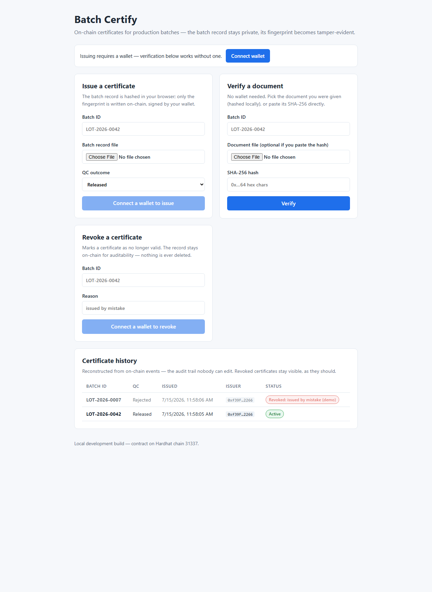

# Batch Certify

On-chain certificates for pharmaceutical production batches. The batch
record never leaves the producer's systems — only its SHA-256 fingerprint
is anchored on-chain, signed by the issuer's wallet, together with the QC
outcome and a timestamp. Anyone holding the original document can verify,
years later and without trusting anybody, that it has not been altered
since certification.

A full-stack dApp: **Solidity** contract (role-based issuance, revocation
with audit trail) + **React / TypeScript** frontend (**wagmi/viem**) with
client-side hashing, wallet-less verification and a live event-driven
history.



> **Context.** Built as a personal project by an automation engineer
> working on GMP pharmaceutical filling lines: the design mirrors how
> batch records and QC decisions actually work (ALCOA+ data integrity,
> separation of duties, never-delete audit trails).

---

## Why hash anchoring (and not data on-chain)

| | Data on-chain | Hash anchoring (this project) |
|---|---|---|
| Privacy | Production data exposed | Document stays private |
| Cost | Grows with data volume | Flat 32 bytes per batch |
| Verification | Read the data back | Recompute SHA-256, compare |

The chain guarantees **integrity** and **existence-at-a-date**; custody of
the document stays where it belongs. Verification is a free `view` call —
a regulator or customer needs no wallet, no account, no gas.

## Contract design (`contracts/BatchCertificate.sol`)

- **`issue(batchId, docHash, qcResult)`** — gated by `ISSUER_ROLE`
  (OpenZeppelin AccessControl). The role admin deliberately *cannot*
  issue: managing accounts and signing certificates are separate duties.
- **`revoke(batchId, reason)`** — flips a flag and emits an event.
  Nothing is ever deleted or overwritten; re-issuing under the same id is
  impossible. Errors are corrected the GMP way: annotate, re-issue under a
  corrected id.
- **`verify(batchId, docHash)`** — the whole point in one `view` call:
  certificate exists ∧ not revoked ∧ hash matches.
- Modern Solidity: custom errors (cheaper than require-strings, decodable
  by the frontend), events carrying both the indexed key (filterable) and
  the human-readable batch id.

## Frontend

- **Client-side hashing** (Web Crypto): the file is fingerprinted in the
  browser and never uploaded anywhere.
- **Wallet-less verification**: reads go through a plain HTTP transport;
  only issuing/revoking needs a connected wallet.
- **Event-driven history**: the audit trail is reconstructed from
  `CertificateIssued` / `CertificateRevoked` logs (storage answers "what
  is the state now", events answer "what happened") and updates live via
  `useWatchContractEvent` + TanStack Query cache invalidation.
- **Typed end-to-end**: the deploy script exports the ABI `as const`, so
  wagmi checks function names and argument types at compile time.
- **Multichain-ready**: deployments are tracked per chain id; the UI
  resolves the right contract address from the connected network.

## Quick start

Prerequisites: Node.js 18+.

```bash
npm install
cd frontend && npm install && cd ..
```

Three terminals:

```bash
npm run node        # 1 — local Hardhat chain on 127.0.0.1:8545 (keep open)
npm run deploy      # 2 — deploy + export address/ABI to the frontend
npm run seed        # 2 — two demo certificates
cd frontend && npm run dev   # 3 — UI on http://localhost:5173
```

**30-second demo**: open the UI → *Verify a document* → batch id
`LOT-2026-0042` → pick `docs/sample-batch-record.txt` → **Authentic**.
Change one character in the file and verify again → **Not valid**.

To exercise issuing/revoking from the UI, add the local chain to MetaMask
(RPC `http://127.0.0.1:8545`, chain id `31337`) and import the first
Hardhat test account. *That key is public and for local use only.*

Utility scripts:

```bash
npm test            # 13 contract tests (roles, duplicates, tampering, revocation)
npm run revoke      # revoke from the CLI (BATCH_ID / REASON env vars)
```

> The local chain lives in memory: restarting the node resets it —
> re-run `deploy` + `seed`.

## Sepolia testnet

```bash
cp .env.example .env     # fill in: RPC url, throwaway private key, Etherscan key
npm run deploy:sepolia
npx hardhat verify --network sepolia <address> <deployer-address>
```

The frontend already knows Sepolia (`frontend/src/wagmi.ts`): switch
MetaMask to Sepolia and the UI picks the right deployment automatically.

## Project layout

```
contracts/BatchCertificate.sol   the contract
test/                            Hardhat + Chai test suite
scripts/                         deploy / seed / revoke (+ node-wait retry helper)
frontend/src/
  wagmi.ts                       chains, transports, connectors
  generated/contract.ts          AUTO-GENERATED address map + as-const ABI
  lib/                           sha256 hashing, QC labels, per-chain address hook
  components/                    ConnectWallet · Issue · Revoke · Verify · History
docs/sample-batch-record.txt     demo document anchored by the seed script
```

## Tech

Solidity 0.8.26 · OpenZeppelin AccessControl · Hardhat · ethers (scripts &
tests) · React 19 · TypeScript · Vite · wagmi · viem · TanStack Query ·
Web Crypto API.

## License

MIT
